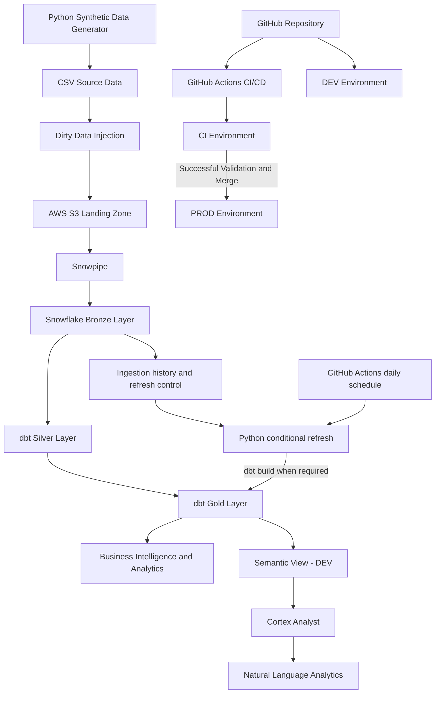
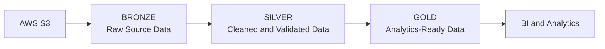
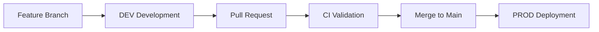
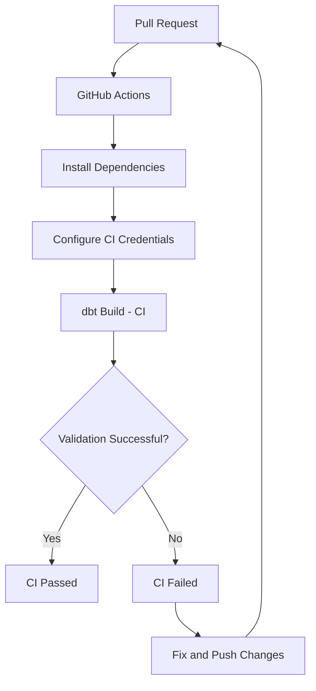
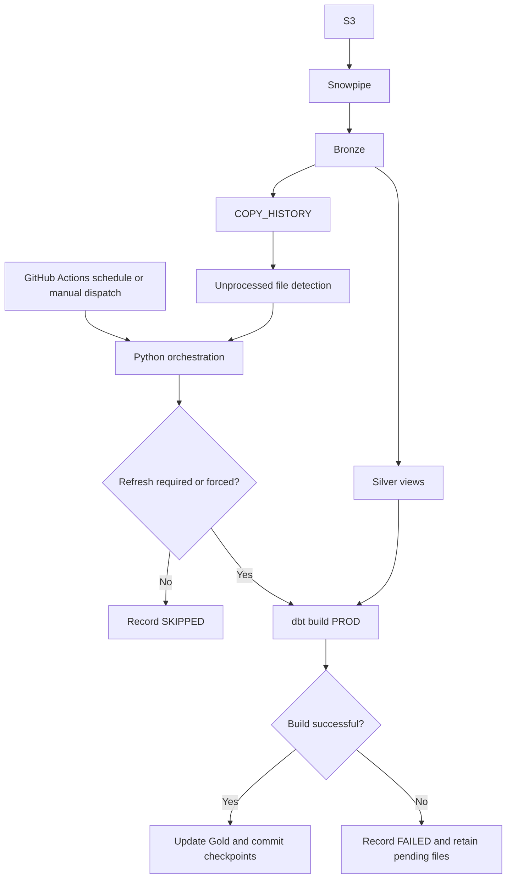
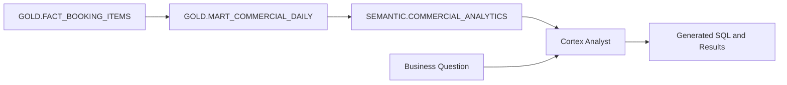

# Travel Data Platform

An end-to-end cloud data engineering platform designed to simulate a modern travel e-commerce data ecosystem using AWS, Snowflake, dbt, Python and GitHub Actions.

The platform demonstrates environment isolation, automated data ingestion, layered data transformation, dimensional modelling, data quality management, role-based access control CI/CD deployment and conditional scheduled Gold refreshes. The platform also includes a DEV-only Snowflake semantic layer and Cortex Analyst integration for natural language analytics.

This README follows a recommended engineering lifecycle rather than the historical learning sequence. Activities such as security, testing, monitoring and documentation evolve iteratively throughout delivery.

---

## Table of Contents

- [1. Project Overview and Business Requirements](#1-project-overview-and-business-requirements)
- [2. Technology Stack](#2-technology-stack)
- [3. System Architecture](#3-system-architecture)
- [4. Data Domains and Source Requirements](#4-data-domains-and-source-requirements)
- [5. Repository and Development Foundation](#5-repository-and-development-foundation)
- [6. Environment Management](#6-environment-management)
- [7. Security and Access Control](#7-security-and-access-control)
- [8. CI/CD Foundation](#8-cicd-foundation)
- [9. Data Ingestion and Bronze Layer](#9-data-ingestion-and-bronze-layer)
- [10. Data Profiling and Quality Framework](#10-data-profiling-and-quality-framework)
- [11. Silver Transformation](#11-silver-transformation)
- [12. Gold and Dimensional Modelling](#12-gold-and-dimensional-modelling)
- [13. Pipeline Orchestration and Data Freshness](#13-pipeline-orchestration-and-data-freshness)
- [14. Monitoring and Observability](#14-monitoring-and-observability)
- [15. Production Validation and Deployment](#15-production-validation-and-deployment)
- [16. Semantic Layer and AI-Enabled Analytics](#16-semantic-layer-and-ai-enabled-analytics)
- [17. Local Development](#17-local-development)
- [18. Implementation Results](#18-implementation-results)
- [19. Engineering Practices](#19-engineering-practices)
- [20. Current Status and Future Enhancements](#20-current-status-and-future-enhancements)
- [21. Conclusion](#21-conclusion)
- [Author](#author)

---

## 1. Project Overview and Business Requirements

The Travel Data Platform processes synthetic travel transaction, customer, product, payment and loyalty data into reliable, analytics-ready datasets.

The project follows an ELT architecture, where source data is extracted and loaded into a cloud data warehouse before being transformed into curated analytical models.

### 1.1 Project Objectives

- Build a scalable cloud-based data platform.
- Establish isolated DEV, CI and PROD environments.
- Implement automated ingestion using AWS S3 and Snowpipe.
- Develop a Bronze, Silver and Gold data architecture.
- Implement reusable and modular dbt transformation models.
- Manage data quality through automated testing and validation.
- Apply dimensional modelling and Slowly Changing Dimensions.
- Implement secure, automated CI/CD deployment.
- Establish traceability, documentation and data lineage.
- Enable reliable downstream business intelligence and analytics.
- Define governed business metrics and enable natural language analytics.

### 1.2 Requirements and acceptance criteria

Define business owners, source contracts, expected volumes, freshness targets and acceptance criteria before implementation. This portfolio uses synthetic travel data and a daily conditional refresh; formal stakeholder SLAs and UAT are not established.

---

## 2. Technology Stack

| Technology | Purpose |
|---|---|
| Python | Synthetic data generation, dirty data injection, ingestion utilities and refresh orchestration |
| AWS S3 | Cloud object storage and ingestion landing zone |
| AWS IAM | Secure AWS resource access |
| Snowpipe | Automated file ingestion |
| Snowflake | Cloud data warehouse and compute |
| SQL | Data transformation and analytical modelling |
| dbt Core | Transformation, testing, documentation and lineage |
| Git | Version control |
| GitHub | Source code management and collaboration |
| GitHub Actions | Continuous integration, deployment and scheduled refresh orchestration |
| AWS CLI | Command-line S3 operations and ingestion testing |
| VS Code | Local development environment |
| YAML | Configuration, source definitions and data tests |
| Snowflake Semantic Views | Governed business dimensions, facts and metrics |
| Snowflake Cortex Analyst | Natural language to SQL analytics |

---

## 3. System Architecture



### 3.1 Architectural Principles

- Environment isolation
- Separation of storage and compute
- ELT-based processing
- Layered data architecture
- Modular and reusable transformations
- Data quality by design
- Least-privilege access
- Automated validation and deployment
- Reproducibility and traceability

The platform follows a three-layer Bronze, Silver and Gold architecture.



---

## 4. Data Domains and Source Requirements

The platform simulates a travel e-commerce business covering customer activity, travel bookings, financial transactions, product information and loyalty membership.

### 4.1 Core Business Domains

| Domain | Data Entities |
|---|---|
| Customers | Customer profiles and addresses |
| Customer Lifecycle | Customer status and membership tier history |
| Bookings | Booking headers and booking items |
| Products | Travel products and categories |
| Vendors | Travel suppliers and vendor information |
| Payments | Payment transactions |
| Refunds | Refund transactions |
| Loyalty | Points earning and redemption transactions |

### 4.2 Business Use Cases

The analytical layer supports use cases including:

- Booking performance analysis.
- Gross sales and gross margin reporting.
- Customer segmentation.
- Customer lifecycle analysis.
- Membership tier progression.
- Payment and refund reconciliation.
- Product and vendor performance.
- Loyalty points earning and redemption analysis.
- Customer-level commercial performance.

---

## 5. Repository and Development Foundation

Establish version control, directory conventions, Python virtual environments, dependencies, dbt project configuration and documentation before pipeline development.

The following represents the main project components.

```text
travel-data-platform/
|
|-- .github/
|   |-- workflows/
|       |-- travel-ci.yml
|       |-- travel-cd.yml
|       |-- travel-scheduled-refresh.yml
|
|-- dbt/
|   |-- models/
|   |-- tests/
|   |-- scripts/
|   |-- dbt_project.yml
|
|-- ingestion/
|   |-- src/
|       |-- upload_to_s3.py
|       |-- upload_test_files.py
|
|-- orchestration/
|   |-- refresh_gold.py
|
|-- snowflake/
|   |-- monitoring/
|   |   |-- 04_data_profiling.sql
|   |   |-- 05_dbt_refresh_control.sql
|   |   |-- snowpipe_monitoring.sql
|   |-- semantic/
|       |-- 01_commercial_analytics.sql
|       |-- 02_customer_analytics.sql
|       |-- 03_financial_analytics.sql
|       |-- 04_loyalty_analytics.sql
|       |-- 05_travel_analytics_agent.sql
|
|-- data/
|-- data_clean/
|-- docs/
|
|-- generate_travel_data.py
|-- generate_test_files.py
|-- inject_dirty_data.py
|-- .gitignore
|-- README.md
```

### 5.1 Component Responsibilities

| Component | Responsibility |
|---|---|
| .github/workflows | Automated CI/CD and scheduled refresh workflows |
| orchestration/refresh_gold.py | Conditional production dbt refresh and checkpoint management |
| dbt/models | Transformation and analytical models |
| dbt/tests | Custom data quality tests |
| dbt/scripts | Transformation development utilities |
| ingestion/src | Source file ingestion utilities |
| snowflake/monitoring | Ingestion monitoring, data profiling and data quality evaluation |
| snowflake/semantic | Version-controlled semantic views and business metric definitions |
| data | Generated source datasets |
| data_clean | Clean source data backups |
| docs | Data quality manifests and project documentation |
| generate_travel_data.py | Synthetic source data generation |
| generate_test_files.py | Controlled ingestion test file generation |
| inject_dirty_data.py | Consolidated dirty data injection |

---

## 6. Environment Management

The platform uses three isolated Snowflake environments to separate development, automated validation and production workloads.

### 6.1 Environment Configuration

| Environment | Database | Purpose |
|---|---|---|
| DEV | TRAVEL_DEV_DB | Local development and model testing |
| CI | TRAVEL_CI_DB | Automated pull request validation |
| PROD | TRAVEL_DB | Production deployment and analytical consumption |

### 6.2 Schema Architecture

| Layer | DEV | CI | PROD |
|---|---|---|---|
| Bronze | Shared source access | Shared source access | Physical source tables |
| Silver | Views | Views | Views |
| Gold | Tables | Tables | Tables |
| Semantic | Implemented | Not deployed | Not deployed |
| Monitoring | Development utilities | Not deployed | Refresh control and ingestion tracking |

DEV and CI use controlled access to the existing Bronze source data while maintaining isolated transformation outputs.

This design avoids unnecessary duplication of raw data while ensuring that development and CI workloads cannot modify production transformation models.

### 6.3 Environment Promotion



dbt transformation changes are developed and tested in DEV, automatically validated in CI and deployed to PROD following a successful merge. Semantic view SQL is version-controlled separately and is not yet included in automated deployment.

---

## 7. Security and Access Control

Security is established before pipeline and transformation development.

### 7.1 Snowflake RBAC

The platform uses role-based access control to separate development, CI and production deployment responsibilities.

Access permissions are assigned according to the principle of least privilege.

| Responsibility | Access Scope |
|---|---|
| Development | Development models and required source data |
| CI validation | CI transformation objects and read-only source access |
| Production deployment | Production transformation objects |
| Data consumption | Approved analytical datasets |

The CI service account is restricted to the permissions required for automated validation.

CI workloads must not create, modify or delete production transformation objects.

### 7.2 AWS IAM

AWS IAM manages access to S3 and the resources required for automated data ingestion.

Security considerations include:

- Restricted S3 bucket access.
- Controlled storage integration permissions.
- Separation of AWS and Snowflake authentication.
- Avoidance of hardcoded credentials.
- Least-privilege access policies.

### 7.3 Secrets Management

Sensitive credentials are managed through environment variables, local configuration and GitHub Actions secrets.

Credentials must not be committed to the repository.

Examples include:

- Snowflake account credentials.
- Service account authentication information.
- AWS access credentials.
- Environment-specific connection settings.

---

## 8. CI/CD Foundation

CI/CD is established early in the project lifecycle and expanded as transformation models and data quality requirements grow.

GitHub Actions automates validation and production deployment.

### 8.1 Continuous Integration

CI is triggered through the pull request workflow.

The CI process includes:

1. Check out the repository.
2. Configure the Python environment.
3. Install required dependencies.
4. Configure Snowflake authentication.
5. Resolve dbt dependencies.
6. Execute dbt models and tests in the CI environment.
7. Report validation results.

CI uses the isolated TRAVEL_CI_DB environment.

Production transformation objects are not modified during pull request validation.




### 8.2 Deployment controls


The deployment design incorporates:

- Environment-specific dbt targets.
- Isolated CI transformation objects.
- Environment-specific authentication.
- Restricted CI permissions.
- Automated data quality validation.
- Git-based change history.
- Pull request-based development.


### 8.3 CI failure handling


The CI workflow reports unsuccessful builds when critical validation fails.

Failed changes should be investigated and corrected in the feature branch before being merged.

Intentional CI failure testing has been performed to validate the failure-handling behaviour.

---

## 9. Data Ingestion and Bronze Layer

### 9.1 Synthetic Data Generation

Python generates synthetic relational datasets representing realistic travel business transactions.

The generated datasets include:

- Primary and foreign key relationships.
- Customer and booking identifiers.
- Transaction timestamps.
- Product and vendor relationships.
- Financial transaction values.
- Historical customer attributes.
- Loyalty points transactions.

Synthetic data allows the platform to demonstrate engineering practices without exposing real customer or commercial information.

### 9.2 Dirty Data Injection

Controlled data quality issues are introduced to simulate realistic upstream data problems.

A consolidated Python script supports four batches of data quality scenarios.

| Batch | Data Quality Scenarios |
|---|---|
| Batch 1 | Missing values, duplicates and invalid business values |
| Batch 2 | Business duplicates, broken foreign keys, formatting issues, invalid date ranges and financial anomalies |
| Batch 3 | Additional invalid values and duplicate records |
| Batch 4 | Invalid numeric, date and timestamp data types |

Individual batches can be executed using:

```bash
python inject_dirty_data.py --batch 1
python inject_dirty_data.py --batch 2
python inject_dirty_data.py --batch 3
python inject_dirty_data.py --batch 4
```

To execute all batches sequentially against a fresh dataset:

```bash
python inject_dirty_data.py --batch all
```

The script retains the original batch-specific random seeds, manifests, backup logic and existing execution safeguards.

Dirty data injection must only be performed against disposable synthetic datasets.

Previously processed datasets must not be reinjected.

### 9.3 AWS S3 Landing Zone

AWS S3 serves as the cloud landing zone for source CSV files.

Python ingestion utilities upload generated datasets to S3 using the AWS SDK.

The landing zone decouples source file generation from warehouse ingestion.

### 9.4 Automated Snowpipe Ingestion

Snowpipe loads source files from S3 into Snowflake Bronze tables.

The ingestion architecture supports:

- Automated file ingestion.
- Asynchronous loading.
- Separation of ingestion and transformation.
- File-level load history.
- Investigation of ingestion failures.

Snowpipe handles source file loading, while dbt manages downstream transformations.

### 9.5 Bronze layer


The Bronze layer stores raw source data ingested from S3.

Responsibilities include:

- Preserving source records.
- Retaining raw values for investigation.
- Supporting downstream reprocessing.
- Providing a consistent source for transformation.
- Maintaining separation between ingestion and business logic.

Bronze data is stored as physical Snowflake tables.

Data quality issues are intentionally retained at this layer.

---

## 10. Data Profiling and Quality Framework

Profile source data before defining cleaning rules. The implemented SQL profiling and quality evaluation is described in Section 14. Tests are developed alongside models, not only at the end.

Data quality is integrated throughout the transformation lifecycle.

The platform uses dbt generic tests and custom SQL tests to validate structural integrity, business rules and relationships.

### 10.1 Structural Validation

- Primary key uniqueness.
- Required field completeness.
- Foreign key relationships.
- Accepted categorical values.
- Valid data types.

### 10.2 Business Rule Validation

- Non-negative financial values where applicable.
- Valid booking date ranges.
- Valid membership tiers.
- Valid transaction statuses.
- Refund amounts relative to associated payments.
- Valid customer and product relationships.

### 10.3 Historical Data Validation

- Effective date consistency.
- Historical customer attribute integrity.
- Valid membership tier history.
- Valid customer status history.

### 10.4 Data Quality Severity

Data quality tests distinguish between critical failures and warning-level issues.

| Severity | Purpose |
|---|---|
| Error | Prevent successful validation when a critical rule fails |
| Warning | Surface issues that require investigation without automatically blocking deployment |

This allows the platform to distinguish deployment-blocking defects from expected or non-critical data quality observations.

### 10.5 Test Execution

Run all models and associated tests:

```bash
dbt build
```

Run data tests independently:

```bash
dbt test
```

Run tests for a selected model:

```bash
dbt test --select model_name
```

---

## 11. Silver Transformation

The Silver layer transforms raw source data into standardised and validated datasets.

Transformation responsibilities include:

- Data type conversion.
- String standardisation.
- Whitespace removal.
- Null handling.
- Duplicate detection and removal.
- Primary key validation.
- Foreign key validation.
- Accepted value validation.
- Date range validation.
- Financial value validation.
- Identification of invalid source records.

Snowflake TRY conversion functions support defensive transformation of malformed source values.

Silver models are implemented primarily as dbt views.

The Silver layer separates source data quality handling from downstream analytical business logic.

---

## 12. Gold and Dimensional Modelling

The Gold layer contains curated datasets designed for reporting and analytical consumption.

Responsibilities include:

- Dimensional modelling.
- Fact and dimension construction.
- Business metric calculation.
- Historical customer analysis.
- Financial and transactional aggregation.
- Customer and loyalty analytics.

Gold models are materialised as Snowflake tables.

This provides a stable analytical interface for downstream consumers. Unlike Silver views, Gold tables require a dbt rebuild to reflect new source data. The conditional refresh workflow addresses this freshness gap.

### 12.1 Dimensional Modelling

The Gold layer applies dimensional modelling principles to separate measurable business events from descriptive business attributes.

Fact models represent transactional and measurable events, including:

- Bookings.
- Booking items.
- Payments.
- Refunds.
- Loyalty points transactions.

Dimension models provide descriptive context, including:

- Customers.
- Products.
- Vendors.
- Product categories.
- Customer membership attributes.

Model grain and key relationships are considered during development to reduce duplication and incorrect aggregation.

### 12.2 Slowly Changing Dimensions

The platform incorporates historical customer attributes through Slowly Changing Dimension concepts.

#### SCD Type 1

Type 1 modelling represents the latest available customer attributes.

Typical use cases include:

- Current customer profile information.
- Updated contact information.
- Current customer attributes.

#### SCD Type 2

Type 2 modelling preserves historical changes through effective date ranges.

Typical use cases include:

- Membership tier history.
- Customer status history.
- Historical address information.

Historical records support point-in-time analysis and customer lifecycle reporting.

### 12.3 Business Metrics

The analytical layer supports calculation and analysis of:

- Gross sales.
- Gross margin.
- Booking volume.
- Payment amounts.
- Refund amounts.
- Customer transaction activity.
- Loyalty points earned.
- Loyalty points redeemed.
- Membership tier activity.

Business calculations are centralised within transformation models to improve consistency and reusability.

---

## 13. Pipeline Orchestration and Data Freshness

### 13.1 Refresh Architecture

Snowpipe automatically loads incoming files into Bronze. Silver views reflect source changes at query time, while materialised Gold tables require a dbt build. A daily conditional refresh closes this gap without rebuilding Gold unnecessarily.



### 13.2 Refresh Control Objects

Implemented in `snowflake/monitoring/05_dbt_refresh_control.sql` in `TRAVEL_DB.MONITORING`.

| Object | Responsibility |
|---|---|
| `DBT_REFRESH_CONTROL` | Pipeline status, timestamps and messages |
| `BRONZE_INGESTION_HISTORY` | Secure view of Bronze file ingestion metadata |
| `DBT_PROCESSED_FILES` | Successfully processed table, filename and load-time combinations |
| `DBT_UNPROCESSED_FILES` | Loaded or partially loaded events with rows that have not been checkpointed |
| `DBT_REFRESH_STATUS` | Pending file count and refresh-required decision |

The file-event approach avoids relying solely on a maximum timestamp, allowing late-arriving metadata to be detected. The production role has scoped access to the monitoring objects.

### 13.3 Execution and Scheduling

- Python entry point: `orchestration/refresh_gold.py`.
- Workflow: `.github/workflows/travel-scheduled-refresh.yml`.
- Daily schedule: `30 19 * * *` UTC (06:30 Melbourne daylight time; 05:30 standard time).
- Manual execution: GitHub Actions → Travel Data Platform Scheduled Refresh → Run workflow on `main`.
- Optional `force_refresh` input bypasses the no-new-data decision.
- Production CD and refresh workflows share the `travel-platform-prod` concurrency group.

The script checks pending ingestion events, runs `dbt build --profiles-dir cd --target prod` when required, and commits the captured file checkpoints only after a successful build. Failed builds retain pending events for retry. A no-change run records `SKIPPED`. Production authentication uses the existing service account and GitHub secrets.

### 13.4 End-to-End Validation

| Scenario | Result |
|---|---|
| Initial refresh | Passed |
| No new data — skip build | Passed |
| Automatic Snowpipe ingestion | Passed |
| Invalid booking and booking-item identifiers rejected by Silver | Passed |
| Corrected records propagated to Bronze and Silver | Passed |
| New ingestion event detection and conditional refresh | Passed |
| Gold metric reconciliation | Passed |
| Successful checkpoint advancement | Passed |

The initial synthetic test used identifiers that violated existing Silver regex rules. Both files were ingested and checkpointed, but Gold correctly remained unchanged. A second test used compliant, unused identifiers and successfully propagated through the pipeline without modifying validation logic.

| Metric | Before | After | Change |
|---|---:|---:|---:|
| Gold booking items | 4,452 | 4,453 | +1 |
| Gold gross sales (AUD) | 11,468,646.04 | 11,473,176.54 | +4,530.50 |

These are observed synthetic-data test results. The final screenshot confirms SUCCESS and an advanced checkpoint; the final pending-file count was not visible.

### 13.5 Operational Limitations

- ACCOUNT_USAGE metadata latency can delay detection; this is daily conditional refresh, not real-time Gold processing.
- Direct Bronze SQL modifications are not detected by file history; use a controlled forced refresh when needed.
- Partially loaded files require investigation even if some rows are processed.
- Gold rebuilds are not atomic across all dbt models; checkpoint updates are transactional.
- Interrupted runs left in RUNNING status require additional recovery hardening.
- Manual dispatch has validated the scheduled workflow logic; unattended daily execution has not yet been verified.

---

## 14. Monitoring and Observability

Status: Basic monitoring implemented.

The platform provides operational visibility across
data ingestion, data quality, transformation execution
and automated deployment.

### 14.1 Ingestion Monitoring

Implemented in:

`snowflake/monitoring/snowpipe_monitoring.sql`

Snowflake ACCOUNT_USAGE.COPY_HISTORY provides file-level
ingestion visibility.

Monitoring capabilities include:

- Recent file loading activity over the previous 24 hours.
- Failed and partially loaded files over the previous 7 days.
- Snowpipe and target table identification.
- File-level ingestion status.
- Error counts and first error messages.
- Load timestamps for incident investigation.

These queries support operational troubleshooting
and ingestion failure investigation.

ACCOUNT_USAGE metadata may have reporting latency
and should not be treated as real-time monitoring.

### 14.2 Data Profiling and Quality Monitoring

Implemented in:

`snowflake/monitoring/04_data_profiling.sql`

The platform includes:

- Source data profiling.
- SQL-based automated data quality evaluation.
- A dedicated data quality results table.
- Identification of data quality issues.

These capabilities complement the dbt transformation
and business rule testing framework.

### 14.3 Transformation Monitoring

dbt provides execution-level visibility through:

- Model execution results.
- Data test results.
- Error and warning severity.
- Failed and skipped model identification.
- Execution logs.

The project contains 387 dbt data tests covering
structural integrity, relationships and business rules.

### 14.4 CI/CD Monitoring

GitHub Actions provides visibility into automated
validation and production deployment.

Monitoring capabilities include:

- Workflow execution status.
- Pull request validation results.
- Production deployment results.
- Step-level execution logs.
- Failed workflow investigation.

Critical CI failures prevent successful validation
and should be resolved before production deployment.

### 14.5 Monitoring Coverage

| Area | Implementation | Status |
|---|---|---|
| Ingestion history | Snowflake COPY_HISTORY | Implemented |
| Ingestion failure detection | SQL monitoring queries | Implemented |
| Data profiling | SQL profiling framework | Implemented |
| Data quality evaluation | SQL-based quality engine | Implemented |
| Data quality results | Dedicated results table | Implemented |
| Transformation validation | dbt models and tests | Implemented |
| CI/CD monitoring | GitHub Actions logs | Implemented |
| Ingestion-driven refresh detection | File-level tracking and refresh status view | Implemented |
| Compute and cost monitoring | Future enhancement | Planned |
| Centralised observability | Future enhancement | Planned |
| Automated operational alerting | Future enhancement | Planned |

### 14.6 Future Enhancements

Potential operational improvements include:

- Source freshness SLA checks and alerts (beyond ingestion-driven refresh detection).
- Centralised operational monitoring views.
- Automated failure notifications.
- Data quality trend dashboards.
- Warehouse usage and cost monitoring.
- Harden interrupted-run recovery and operational scheduling.
- Operational incident management procedures.

The current implementation provides a foundational
monitoring capability without introducing unnecessary
infrastructure complexity.

---

## 15. Production Validation and Deployment

Validate model grain, relationships, critical tests, environment isolation and end-to-end reconciliation before production promotion. Formal business UAT and operational sign-off are recommended but not implemented in this synthetic project.

### 15.1 Continuous deployment


CD is triggered following changes merged into the main branch.

The deployment workflow:

1. Checks out the merged code.
2. Configures production authentication.
3. Installs required dependencies.
4. Executes dbt models and tests against PROD.
5. Reports deployment results.

The production deployment command is:

```bash
dbt build --profiles-dir cd --target prod
```

Production models are deployed into TRAVEL_DB.

---

## 16. Semantic Layer and AI-Enabled Analytics

### 16.1 Architecture and Scope

The native Snowflake semantic layer extends the existing Gold layer without duplicating its data. The current implementation is deployed in DEV only.



| Property | Definition |
|---|---|
| Deployed object | `TRAVEL_DEV_DB.SEMANTIC.COMMERCIAL_ANALYTICS` |
| Source | `GOLD.MART_COMMERCIAL_DAILY` |
| Grain | One row per transaction date and product |
| Source filter | Booking items with positive gross sales |
| Logical tables | 1 |
| Dimensions | 13 |
| Facts | 7 |
| Metrics | 9 |
| Development role | `TRAVEL_DEV_ROLE` |
| AI access | `SNOWFLAKE.CORTEX_ANALYST_USER` database role |
| Version-controlled definition | `snowflake/semantic/01_commercial_analytics.sql` |

### 16.2 Business Metric Governance

Dimensions cover transaction dates, calendar and financial periods, products, destinations, categories and vendors. Facts represent sales, margin, discounts, refunds, booking item counts, room nights and item-level traveller counts.

| Metric | Aggregation |
|---|---|
| Total sales | SUM of gross sales (AUD) |
| Total margin | SUM of gross margin (AUD) |
| Total discount | SUM of discounts (AUD) |
| Total refund | SUM of refunds (AUD) |
| Total booking items | SUM of booking item counts |
| Total room nights | SUM of room nights |
| Total travellers | SUM of item-level traveller counts, not unique individuals |
| Gross margin rate | SUM of margin / NULLIF(SUM of sales, 0) |
| Average booking item value | SUM of sales / NULLIF(SUM of booking item counts, 0) |

Ratios are recalculated from aggregate components rather than averaging precomputed row-level ratios. Distinct booking and customer counts are excluded because they are non-additive at the daily product grain. Accurate unique counts require a suitable lower-grain source.

### 16.3 Development and Reproducibility

The DEV semantic schema and permissions are configured before creating the view. The SQL definition uses schema-qualified names without hardcoding a database. Before executing it, explicitly select the intended database and ensure the target semantic schema, source objects and permissions exist.

For the existing DEV environment:

```sql
USE ROLE TRAVEL_DEV_ROLE;
USE DATABASE TRAVEL_DEV_DB;
USE SCHEMA SEMANTIC;
```

Execute the version-controlled SQL definition when intentionally creating or replacing the view. Do not replace the existing object merely to reproduce the initial tests.

Cortex Analyst is accessed through Snowsight Workspaces using the linked semantic view and Playground. The development role is used for testing. No external LLM API key or separate application is required for this implementation.

### 16.4 Semantic Metric Reconciliation

Five semantic metrics matched direct Gold mart SQL results in the initial DEV test:

| Metric | Reference result |
|---|---:|
| Total sales | AUD 11,468,646.04 |
| Total margin | AUD 2,137,825.03 |
| Booking items | 4,452 |
| Gross margin rate | 18.640605% |
| Average booking item value | AUD 2,576.06604672 |

These are observed synthetic-data results, not fixed expectations for future data refreshes.

### 16.5 Initial Cortex Analyst Functional Testing

| Test | Question | Result |
|---|---|---|
| 1 | What are the total sales? | Passed; exact sales match |
| 2 | What are the total gross sales, gross margin and gross margin rate? | Passed; all three metrics matched |
| 3 | What are the top 5 destinations by total gross sales? | Passed; all five destinations and values matched |
| 4 | Show monthly gross sales and gross margin for 2025. | Partial; seven visible months matched; reference SQL returned 12 months |
| 5 | Which product category has the highest gross margin rate? | Passed; Experiences, 27.429078% |
| 6 | How many unique customers do we have? | Passed; correctly identified unsupported metric |

Five of six functional tests are fully verified. The remaining test is partially verified. This small sample does not establish general AI accuracy. The first query also returned redundant date columns without affecting its sales result.

### 16.6 Additional DEV Semantic Work

Customer, financial and loyalty semantic views have also been created in DEV, with individual Playground checks reported complete. All four semantic view SQL definitions and the four-tool Cortex Agent configuration are integrated into main. Agent preview is blocked by trial-account access restrictions; the agent is not published. Formal reconciliation and benchmark evaluation remain outstanding.

### 16.7 Limitations and Next Steps

- Semantic view deployment is currently DEV-only; CI and PROD semantic deployment are not implemented.
- Existing GitHub Actions workflows validate and deploy dbt models, not semantic view SQL.
- The portable SQL definition has not yet been tested in CI or PROD.
- The commercial semantic view does not support unique customer counts or all loyalty and financial use cases.
- Formal benchmark evaluation, verified query optimisation and regression testing are planned.

---

## 17. Local Development

### 17.1 Prerequisites

- Python
- Git
- AWS CLI
- Snowflake account
- AWS account
- dbt Core
- Snowflake dbt adapter

### 17.2 Clone the Repository

```bash
git clone https://github.com/youkeefan/travel-data-platform.git
cd travel-data-platform
```

### 17.3 Configure the Python Environment

Create a virtual environment:

```bash
python -m venv .venv
```

Activate the environment on Windows:

```powershell
.\.venv\Scripts\Activate.ps1
```

Install project dependencies using the repository's dependency configuration.

### 17.4 Configure Environment Connections

Configure the required AWS and Snowflake credentials.

Ensure that:

- Local development uses the DEV target.
- CI uses the CI target.
- Production deployment uses the PROD target.
- Credentials are excluded from version control.

### 17.5 Generate Source Data

For a new synthetic dataset:

```bash
python generate_travel_data.py
```

Optionally introduce controlled data quality issues:

```bash
python inject_dirty_data.py --batch all
```

These commands are intended for initial dataset preparation or controlled testing.

Do not regenerate or reinject existing datasets unless intentionally resetting the local test environment.

### 17.6 Upload Source Data

Upload prepared source files to the configured S3 landing zone:

```bash
python ingestion/src/upload_to_s3.py
```

Snowpipe processes the uploaded files into the Bronze layer.

### 17.7 Execute dbt

Navigate to the dbt project directory:

```bash
cd dbt
```

Install dbt package dependencies:

```bash
dbt deps
```

Validate the development connection:

```bash
dbt debug --target dev
```

Build development models and execute tests:

```bash
dbt build --target dev
```

Generate dbt documentation:

```bash
dbt docs generate --target dev
```

Serve documentation locally:

```bash
dbt docs serve
```

### 17.8 Feature Development

Create a feature branch:

```bash
git checkout main
git pull origin main
git checkout -b feature/model-update
```

Develop and validate changes in DEV.

Stage and commit the changes:

```bash
git add .
git commit -m "feat: update transformation models"
```

Push the feature branch:

```bash
git push -u origin feature/model-update
```

Create a pull request targeting main.

GitHub Actions executes the CI workflow.

Review validation results before merging.

Following a successful merge, the CD workflow deploys the updated dbt models to PROD. Semantic view deployment remains manual and DEV-only.

---

## 18. Implementation Results

The platform has successfully implemented automated ingestion, isolated transformation environments and CI/CD deployment.

### 18.1 Warehouse Objects

| Environment | Bronze Tables | Silver Views | Gold Tables |
|---|---:|---:|---:|
| PROD | 15 | 21 | 16 |
| DEV | Shared source access | 21 | 16 |
| CI | Shared source access | 21 | 16 |

### 18.2 dbt Project

| Component | Count |
|---|---:|
| dbt Models | 37 |
| Data Tests | 387 |
| Source Definitions | 15 |

### 18.3 Recorded Production Build (Day 5)

| Result | Count |
|---|---:|
| Passed | 413 |
| Warnings | 11 |
| Errors | 0 |
| Skipped | 0 |
| Total Executed Nodes | 424 |

The production build completed successfully with no errors.

Warning-level results remain visible for data quality investigation.

### 18.4 Engineering Capabilities

- Automated cloud ingestion.
- Layered ELT transformation.
- Isolated development environments.
- Automated pull request validation.
- Automated production deployment.
- Dimensional modelling.
- Historical customer modelling.
- Defensive data type conversion.
- Automated data quality testing.
- Role-based access control.
- Controlled synthetic data quality scenarios.
- Native semantic view and governed metrics in DEV.
- Natural language analytics with initial SQL reconciliation.
- Conditional scheduled Gold refresh with file-level checkpoint tracking.

---

## 19. Engineering Practices

### 19.1 Version Control

All transformation and configuration changes are managed through Git.

Feature branches and pull requests provide traceability and controlled integration.

### 19.2 Modularity

Transformation logic is separated into reusable models with clearly defined responsibilities.

### 19.3 Data Quality

Validation rules are implemented alongside transformation logic.

### 19.4 Environment Isolation

Development, automated validation and production workloads operate in separate transformation environments.

### 19.5 Security

Access permissions follow the principle of least privilege.

Sensitive credentials are managed outside version control.

### 19.6 Reproducibility

Synthetic data generation, controlled dirty data injection and version-controlled transformations support repeatable development and testing.

### 19.7 Documentation

dbt documentation, source definitions and model descriptions support discoverability and maintainability.

### 19.8 Cost Awareness

The platform uses shared Bronze source access and separates transformation environments to reduce unnecessary raw data duplication. Conditional refresh checks also avoid unnecessary dbt builds when no new ingestion events are detected.

---

## 20. Current Status and Future Enhancements

| Component | Status |
|---|---|
| Architecture Design | Implemented |
| Synthetic Data Generation | Implemented |
| Dirty Data Injection | Implemented |
| AWS S3 Integration | Implemented |
| Snowpipe Ingestion | Implemented |
| Bronze Layer | Implemented |
| Silver Layer | Implemented |
| Gold Layer | Implemented |
| Dimensional Modelling | Implemented |
| Historical Data Modelling | Implemented |
| Data Quality Testing | Implemented |
| DEV / CI / PROD Isolation | Implemented |
| Role-Based Access Control | Implemented |
| Continuous Integration | Implemented |
| Continuous Deployment | Implemented |
| CI Failure Validation | Implemented |
| Basic Monitoring and Observability | Implemented |
| Conditional Gold Refresh | Implemented and manually validated |
| Unattended Daily Execution | Configured; not yet verified |
| Advanced Observability and Alerting | Future Enhancement |
| Four semantic views | Implemented in DEV; SQL integrated into main |
| Cortex Agent | Configuration integrated; unpublished; trial blocks runtime testing |
| Cortex Analyst | Implemented in DEV |
| Initial AI Functional Testing | Five passed; one partially verified |
| Formal AI Evaluation and Verified Queries | Planned |
| Semantic CI/CD and PROD Deployment | Future Enhancement |

### 20.1 Recommended next improvements

- Formal semantic metric reconciliation, benchmark evaluation and verified queries.
- Incremental transformations, API ingestion and controlled backfill.
- Interrupted-run recovery, freshness SLAs and automated alerting.
- Schema evolution, infrastructure as code and cost monitoring.
- Semantic CI/CD and production deployment.

These are proposed enhancements, not implemented capabilities.

---

## 21. Conclusion

The Travel Data Platform demonstrates the design and implementation of an end-to-end cloud data engineering solution using modern data engineering technologies.

The project combines automated ingestion, modular ELT transformations, dimensional modelling, data quality management, environment isolation, CI/CD and ingestion-driven conditional refresh into a unified architecture.

Its design emphasises engineering reliability, maintainability, security and reproducibility while supporting scalable downstream business analytics. The DEV semantic layer extends these foundations to governed natural language analytics, with formal AI evaluation and production semantic deployment remaining future work.

---

## Author

Yujia Fan

Data Analytics | Analytics Engineering | Data Engineering
