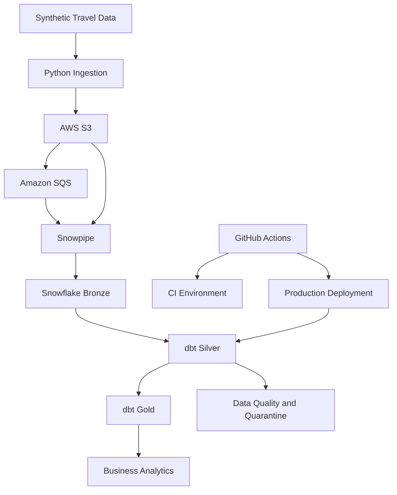
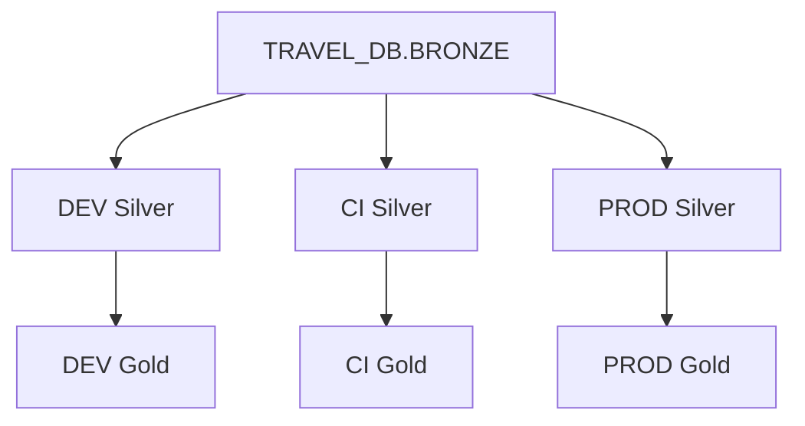
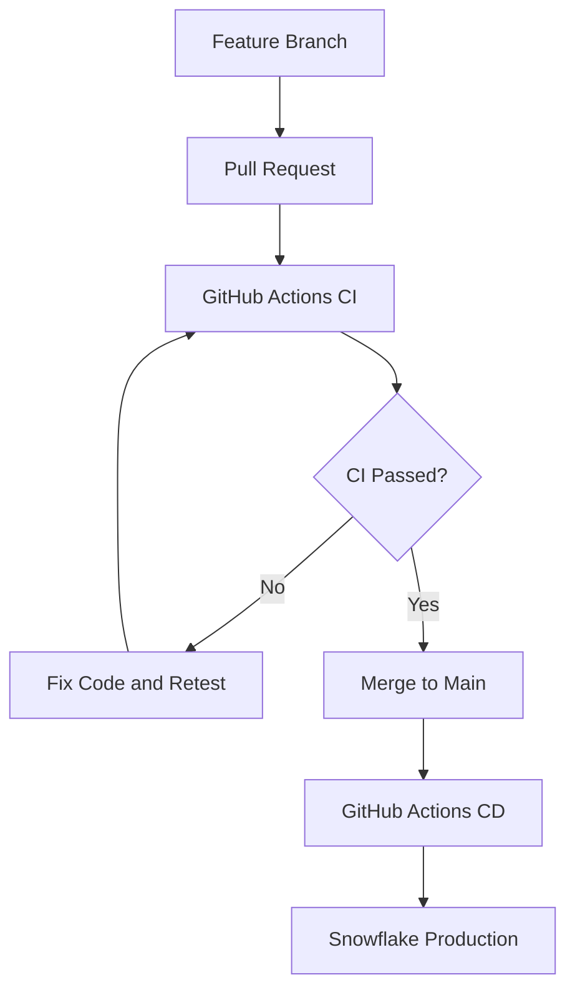

# Travel Data Platform

An end-to-end data engineering project simulating a production-style travel e-commerce data platform, covering automated data ingestion, cloud data warehousing, data transformation, dimensional modelling, data quality management and CI/CD.

## 1. Project Overview

The platform integrates synthetic travel booking, customer, product, payment, refund and loyalty data into a centralised Snowflake data warehouse.

The project demonstrates how raw operational data can be transformed into reliable, analytics-ready datasets through a scalable, modular and environment-separated data architecture.

### Project Objectives

- Build an end-to-end cloud-based ELT pipeline.
- Automate file ingestion using AWS and Snowflake.
- Implement a Bronze, Silver and Gold data architecture.
- Develop reusable and modular dbt transformation models.
- Implement dimensional modelling and historical customer tracking.
- Detect and quarantine invalid data.
- Establish separate development, testing and production environments.
- Automate testing and deployment through CI/CD.
- Implement role-based access control and secure authentication.

## 2. Technology Stack

| Technology | Purpose |
|---|---|
| Python | Synthetic data generation, dirty data simulation and ingestion automation |
| AWS S3 | Cloud object storage |
| AWS IAM | Cloud access and permission management |
| Amazon SQS | Event notifications for automated ingestion |
| Snowpipe | Automated data ingestion |
| Snowflake | Cloud data warehouse |
| SQL | Data transformation and business logic |
| dbt Core | ELT modelling, testing and dependency management |
| Git | Version control |
| GitHub | Source code management |
| GitHub Actions | Automated CI/CD |
| RSA Key Pair | Secure Snowflake service account authentication |
| YAML | Model, source, test and workflow configuration |

## 3. System Architecture



The platform follows an ELT architecture, loading raw data into Snowflake before applying transformations using dbt.

## 4. Data Architecture

### Bronze Layer — Raw Data

The Bronze layer contains 15 raw source tables representing operational travel business data.

Source domains include:

- Bookings and booking items
- Booking status history
- Customer profiles and addresses
- Customer tier and status history
- Products, categories, offers and packages
- Payments and refunds
- Loyalty points transactions

Raw data is ingested through AWS S3 and Snowpipe, providing a foundation for downstream transformations.

### Silver Layer — Data Transformation

The Silver layer contains 21 dbt views covering staging, intermediate transformations, customer consolidation and data quality management.

Key transformation processes include:

- Data type standardisation
- Deduplication
- Null value handling
- Referential integrity validation
- Customer profile consolidation
- Historical tier and status management
- Financial record validation
- Date consistency checks
- Invalid record identification and quarantine

### Gold Layer — Analytics and Business Modelling

The Gold layer contains 16 materialised tables, including fact tables, dimension tables and analytical marts.

Business modelling covers:

- Booking and transaction analysis
- Customer analytics
- Payment and refund analysis
- Commercial performance
- Revenue and margin reporting
- Loyalty analytics
- Daily commercial performance reporting

The Gold layer provides structured, analytics-ready datasets for downstream reporting and business intelligence.

## 5. Data Quality Management

The platform incorporates intentionally corrupted synthetic data to simulate real-world operational data quality challenges.

Data quality scenarios include:

- Duplicate records
- Missing foreign keys
- Invalid data types
- Invalid booking dates
- Negative financial amounts
- Duplicate transaction references
- Invalid customer email addresses
- Missing postcodes
- Overlapping customer tier and status periods
- Refund amount and currency inconsistencies
- Cumulative over-refunding

Data quality controls are implemented using dbt generic tests, singular SQL tests and business validation rules.

### Test Severity

| Severity | Behaviour |
|---|---|
| ERROR | Fails the dbt build and prevents successful CI execution |
| WARN | Identifies data quality exceptions without failing the build |

Invalid records are identified through dedicated quarantine and validation models.

### Latest Production Build

| Metric | Result |
|---|---:|
| Source tables | 15 |
| Silver views | 21 |
| Gold tables | 16 |
| Total dbt models | 37 |
| Data tests | 387 |
| Total executed nodes | 424 |
| Passed nodes | 413 |
| Warnings | 11 |
| Errors | 0 |
| Skipped nodes | 0 |

The warning-level results demonstrate the platform's ability to identify data quality exceptions while allowing non-blocking issues to be reported.

## 6. Environment Management

Three separate Snowflake environments support development, automated testing and production deployment.

| Environment | Database | Role |
|---|---|---|
| DEV | TRAVEL_DEV_DB | TRAVEL_DEV_ROLE |
| CI | TRAVEL_CI_DB | TRAVEL_CI_ROLE |
| PROD | TRAVEL_DB | TRAVEL_PROD_ROLE |

Each environment contains its own Silver and Gold transformation objects.

The production Bronze layer serves as the shared raw data source.



This architecture supports independent development and automated testing without requiring duplicate raw data ingestion.

## 7. CI/CD Pipeline

GitHub Actions automates model validation and production deployment.

### Continuous Integration

The CI workflow is triggered by pull requests and performs:

- Python environment configuration
- dbt dependency installation
- Snowflake authentication
- CI environment connection validation
- dbt model execution
- Automated data quality testing

CI transformations are executed in TRAVEL_CI_DB.

### Continuous Deployment

The CD workflow is triggered by changes merged into the main branch and performs:

- Production environment authentication
- Production connection validation
- dbt model deployment
- Production data quality testing

Production deployment uses the dbt production target.



### Branch Protection

The main branch is protected through GitHub branch protection rules and required CI status checks.

Intentional CI failure testing was performed to validate the failure-handling process.

## 8. Security and Access Control

The platform implements Snowflake role-based access control to separate development, testing and production responsibilities.

Security controls include:

- Dedicated environment roles
- Dedicated CI service account
- Environment-specific compute resources
- RSA key-pair authentication
- GitHub Secrets for sensitive credentials
- Restricted CI write privileges
- Read-only CI access to production Bronze data
- Existing and future grant management
- Removal of unnecessary backup database permissions

The security architecture follows the principle of least privilege.

## 9. Repository Structure

```text
travel-data-platform/
├── .github/
│   └── workflows/
│       ├── travel-ci.yml
│       └── travel-cd.yml
├── dbt/
│   ├── models/
│   │   ├── silver/
│   │   └── gold/
│   ├── tests/
│   └── dbt_project.yml
├── ingestion/
│   └── src/
├── snowflake/
├── docs/
├── generate_travel_data.py
├── generate_test_files.py
├── inject_dirty_data.py
├── requirements.txt
├── .gitignore
└── README.md
```

## 10. Local Development

### Prerequisites

- Python
- Git
- Snowflake account
- AWS account
- Configured AWS credentials
- Configured dbt profiles
- Required Snowflake roles and permissions

### Clone the Repository

```bash
git clone https://github.com/youkeefan/travel-data-platform.git
cd travel-data-platform
```

### Configure Python Environment

```powershell
python -m venv .venv
.venv\Scripts\Activate.ps1
pip install -r requirements.txt
```

### Execute dbt

```bash
cd dbt
dbt deps
dbt debug --target dev
dbt build --target dev
```

Local dbt execution requires a correctly configured Snowflake development profile.

Production deployment is managed through GitHub Actions rather than manual local execution.

## 11. Engineering Practices

- Modular ELT architecture
- Separation of storage and compute
- Medallion architecture
- Dimensional modelling
- Slowly changing dimensions and historical tracking
- Automated data quality testing
- Data quarantine
- Infrastructure and environment separation
- Role-based access control
- Secure service account authentication
- Version-controlled transformations
- Automated integration and deployment

## 12. Project Roadmap

- [x] Synthetic data generation
- [x] AWS S3 and Snowpipe ingestion
- [x] Bronze layer implementation
- [x] Silver transformation layer
- [x] Gold dimensional modelling
- [x] Data quality and quarantine
- [x] DEV, CI and PROD environment management
- [x] Role-based access control
- [x] GitHub Actions CI/CD
- [x] Production deployment
- [ ] Monitoring and observability

## 13. Disclaimer

This project uses synthetic data and is designed for educational and portfolio purposes. It does not contain real customer information or proprietary business data.

The platform demonstrates production-oriented data engineering practices within a personal cloud development environment.